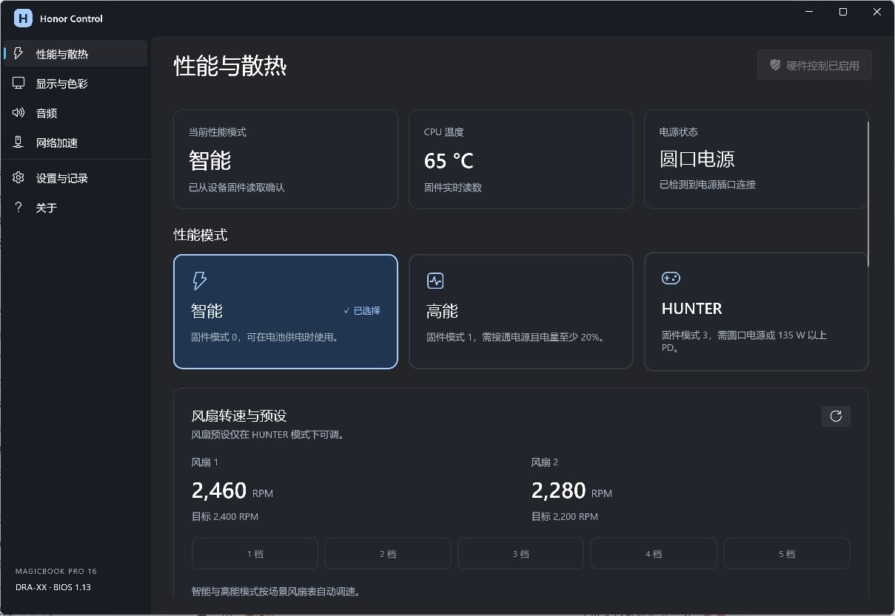
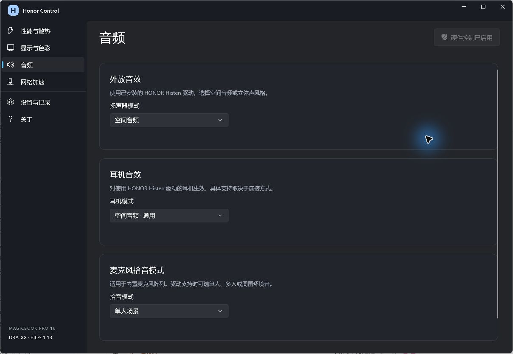
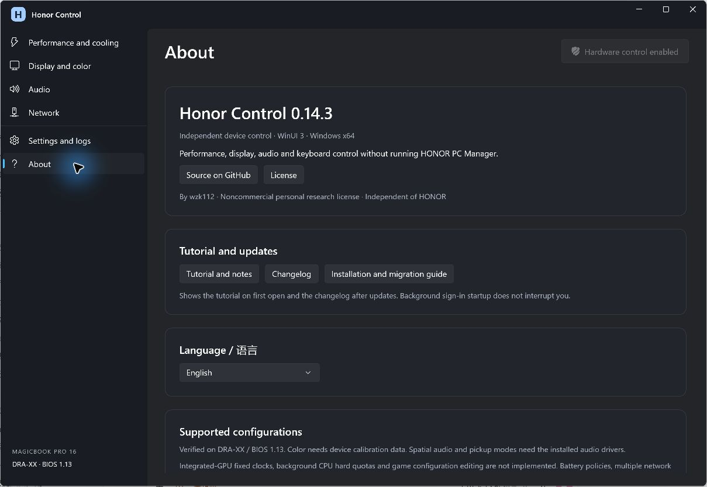

# Honor Control

[简体中文](README.md) · [Downloads](https://github.com/wzk112/HonorControl/releases) · [Installation](INSTALL.en-US.md) · [Changelog](CHANGELOG.md)

Independent WinUI 3 device controls for **HONOR MagicBook Pro 16 DRA-XX / BIOS 1.13**, without running HONOR PC Manager. Chinese and English UI are included.

**Source available for noncommercial personal use and personal research only. Commercial use is prohibited.** See the [Honor Control Personal Research License 1.0](LICENSE). This is not an OSI open-source license. This project is independent of HONOR.





## Features

- Smart, Performance and HUNTER modes; five HUNTER fan presets; firmware mode, level, temperature and RPM readback.
- Automatic performance retains a recognized game across focus changes, with a 45-second grace period when processes disappear. Successful manual changes disable automatic mode.
- OS Turbo coordinates Windows EPP, Intel DTT PL1 requests, EPO, fan tables and NVIDIA offsets. Process scheduling provides HighQoS / EcoQoS and selected game affinity rules. Changes have recovery journals.
- Discrete-GPU power policy, charging thresholds, internal refresh rate selection, hardware gamut LUT plus ICC, SDR display effects and cyclic brightness.
- Histen speaker / headphone spatial audio presets and Fortemedia single-person, group and ambient microphone pickup.
- Fn+P, Fn+R, saved F1–F12 defaults, customizable alternative shortcuts and function-specific notifications. Brightness and volume remain with Windows.
- Outbound DSCP priorities, background upload limits, saved WLAN selection / reconnection and an internal parallel downloader.
- Program Files installation, sign-in startup, tray operation, background recovery, tutorial, changelog and About page.

## Install

Download `HonorControl-0.14.3-Setup-x64.exe` from [Releases](https://github.com/wzk112/HonorControl/releases), double-click it and approve UAC once. The installer handles files, the Start menu and sign-in tasks. No manual PowerShell step is required.

The target is `C:\Program Files\HonorControl` with two sign-in tasks, `HonorControl.Agent` and `HonorControl.UI`. Start from the Start menu. Closing the window keeps the tray active. Exiting from the tray pauses until next sign-in or manual launch. Upgrades preserve preferences.

**Public packages omit device-specific ICC / LUT calibration. Color switching needs calibration belonging to the same physical panel.** Import an existing local Honor Control backup with `Import-Calibration.ps1`. Other features remain available without it. OEM DLLs and drivers are not bundled.

Uninstall HONOR PC Manager, separate OSD, HUNTERCAMP, Magic Animation and YOYO software if replacing their controls. Keep Intel, NVIDIA, Realtek, Fortemedia, Histen, ACPI and other hardware drivers, audio services and calibration folders. The cleanup script previews its exact scope by default and only applies with `-Apply`. See the [migration guide](INSTALL.en-US.md).

## Compatibility and limitations

The verified device is DRA-XX, BIOS 1.13, Core Ultra 5 125H / RTX 4060. Firmware writes are guarded. Performance needs AC and at least 20% battery; HUNTER requires barrel-jack power or at least 135 W PD. Levels 4–5 require a supported 200 W adapter.

Other configurations of the same model need feature-specific validation. Scene DTT writes require 125H; NVIDIA offsets require RTX 4060 Laptop GPU. Selected affinity rules cover 125H and 155H. General firmware controls check model and BIOS but are not proof of full compatibility. Different laptop models are unsupported even with the same CPU / GPU.

There are 476 game-category executable rules, including multiple processes for some games. Launchers and common helpers are excluded from automatic game sessions. Examples include CS2, League of Legends, PUBG, CrossFire, Chinese Genshin Impact and Star Rail builds, Zenless Zone Zero, Black Myth, Cyberpunk 2077, GTA V, RDR2, Elden Ring, Sekiro, BG3, Overwatch, Valorant and Apex. Filename matching is not per-title benchmark validation. Region and updates can change process names. See the [rules](App/Assets/DarwinAScenes.tsv).

Automatic performance, process scheduling and OS Turbo start disabled on a fresh install. HUNTER retains firmware power control and the selected fan preset; scene EPP pauses in HUNTER as expected.

OEM fixed 2200 MHz integrated-GPU clocks, 1% / 10% background CPU hard quotas and game configuration editing are not implemented. The Intel driver reports its GPU frequency domain cannot be controlled. This is not a complete reproduction of all OEM policies. Twenty-eight AC DTT policies, both NVIDIA offset presets and recovery, and all three microphone RPC modes were verified on this device. Battery policies have not each been tested unplugged. Headphone listening, multi-path aggregation and latency benefits are not fully tested.

Color supports the calibrated internal panel in SDR. HDR, automatic color management, direct discrete-GPU display output and external multi-display color are not fully validated. Audio needs the corresponding installed driver and endpoint. DSCP handling depends on the router and network. WLAN respects Windows privacy permissions. Phone collaboration and browser download interception are excluded.

## Build and data

Windows x64, .NET 8 SDK and Windows desktop build prerequisites:

```powershell
.\Build.ps1 -OutputDirectory .\artifacts\HonorControl -WithoutCalibration
```

`App` contains WinUI, `Broker` the privileged allowlisted commands and controllers, `Shared` the protocol / scene tables, and `BackendSource` the installed-driver interfaces. Output includes .NET and Windows App SDK runtimes. Supply local calibration with `-CalibrationDirectory` in a fresh output directory, or import it into an extracted package.

Preferences, logs and recovery records stay in `%LOCALAPPDATA%\HonorControl`. There is no automatic log upload or update check. Documentation links open a browser; network features access the network when used. Personal state, user SIDs, registry / recovery backups, OEM binaries and calibration data are excluded from the repository. Dependencies retain their own licenses; see [third-party notices](THIRD-PARTY-NOTICES.md).

Build the installer with Build-Installer.ps1 -PackageDirectory .\artifacts\HonorControl. Uninstall through Windows Installed apps. Preferences, logs, calibration and hardware drivers are retained.

Runtime logs rotate at 2 MiB with three files per stream. Logs not updated for 14 days are removed. Recovery records, preferences and calibration backups are retained.
