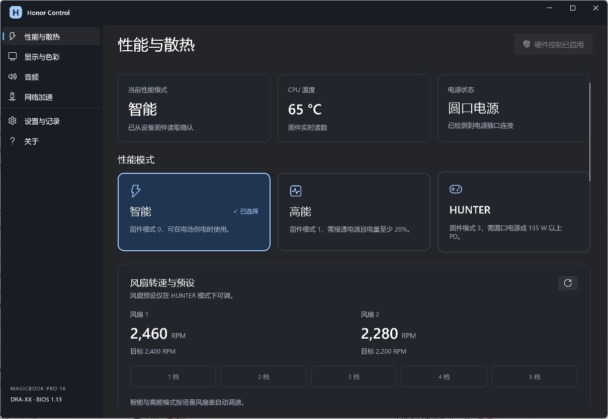
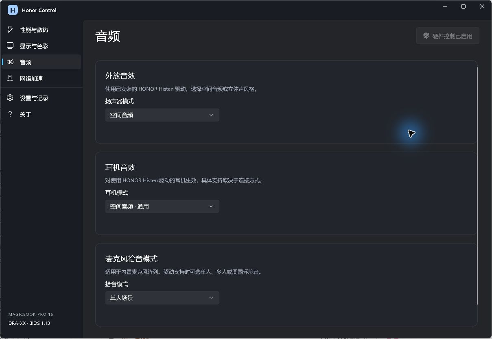
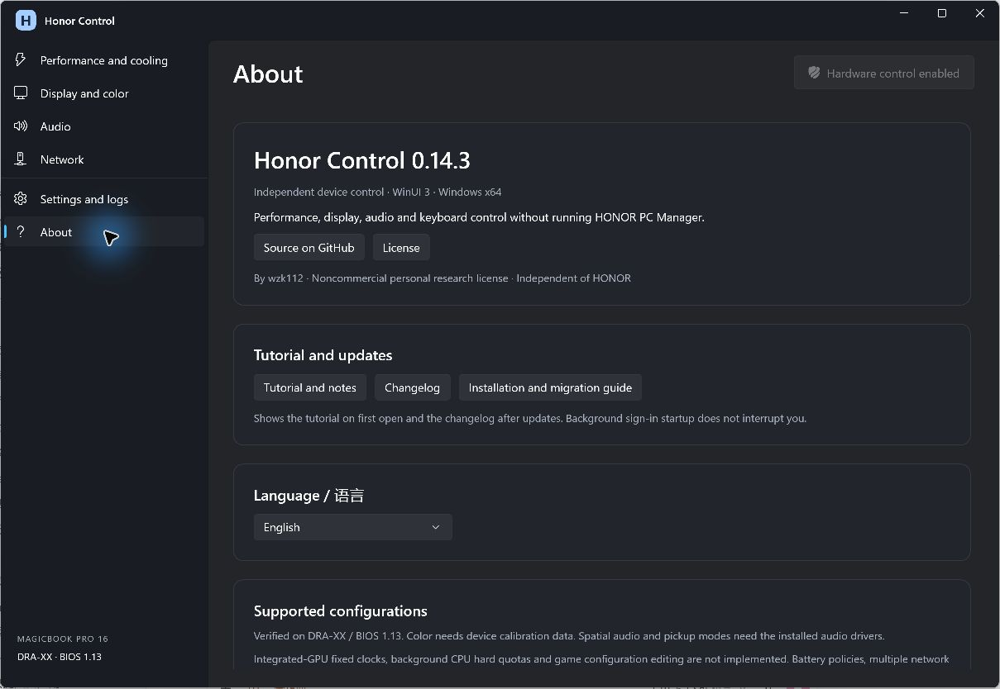

# Honor Control

[English](README.en-US.md) · [下载](https://github.com/wzk112/HonorControl/releases) · [安装与迁移](INSTALL.zh-CN.md) · [更新记录](CHANGELOG.md)

面向 HONOR MagicBook Pro 16 **DRA-XX / BIOS 1.13** 的独立 WinUI 3 设备控制工具。无需运行荣耀电脑管家。支持简体中文和 English。

**源码公开，仅限非商业个人使用与研究。禁止商用。** 采用 [Honor Control Personal Research License 1.0](LICENSE)，该限制不属于 OSI 定义的开源许可。非荣耀官方产品。



## 功能

| 项目 | 当前支持 |
| --- | --- |
| 性能与风扇 | 智能、高能、HUNTER；HUNTER 五档风扇预设；固件读回模式、档位、温度与转速 |
| 自动性能 | 按运行中的游戏与前台场景选择模式；游戏进程存在时保持，消失后有 45 秒缓冲；手动切换成功后关闭自动控制 |
| OS Turbo 场景调度 | Windows EPP、DTT PL1 请求、EPO、风扇表与 NVIDIA 频偏；退出或关闭后按恢复记录还原应用修改 |
| 进程调度 | 指定前台 HighQoS、后台 EcoQoS；自动识别游戏、会议与创作程序；部分游戏核心分配 |
| 显卡电源 | 双显卡、集显与随供电自动切换；空闲等待与占用保护；强制集显另行确认 |
| 充电保护 | 家用 40–70%、办公 70–90%、差旅 95–100% |
| 显示 | 内屏刷新率直接选择；原生、sRGB、P3 硬件 LUT 与 ICC；护眼、电子书、色温及周期亮度 |
| 音频 | Histen 外放空间音频和立体声预设；耳机空间预设；Fortemedia 单人、多人和环境拾音 |
| Fn 与浮窗 | Fn+P、Fn+R、F1–F12 默认行为、自定义备用快捷键；功能对应图标；受限切换显示原因 |
| 网络 | 出站 DSCP 优先级、后台上传限速、已保存 WLAN 选网与断线重连、内置并行下载 |
| 常驻与界面 | Program Files 安装、登录启动、托盘常驻、后台恢复；教程、更新记录、关于页及系统动画偏好 |




## 安装

在 [Releases](https://github.com/wzk112/HonorControl/releases) 下载 `HonorControl-0.14.3-Setup-x64.exe`，双击并授权一次 UAC。安装器完成文件复制、开始菜单和登录启动注册，无需手动运行 PowerShell。

安装到 `C:\Program Files\HonorControl`，注册 `HonorControl.Agent` 和 `HonorControl.UI` 两项登录任务。从开始菜单打开，首次前台打开显示使用说明。关闭窗口后托盘继续运行，右键托盘退出可暂停当前登录会话。升级保留个人设置。

公共包不包含原厂 DLL、驱动和本机 ICC/LUT 数据。**色彩功能需要另行导入对应物理内屏的本机校准文件**，没有这些文件时保留其他功能。已有 Honor Control 本机备份可通过 `Import-Calibration.ps1` 导入。不要使用其他面板的校准数据。详见[安装指南](INSTALL.zh-CN.md)。

荣耀电脑管家、独立 OSD、HUNTERCAMP、Magic 视界及 YOYO 等软件后台可卸载。**保留 Intel / NVIDIA / Realtek / Fortemedia / Histen / ACPI 等硬件驱动、音频服务和校准目录。** 清理脚本默认只列计划，显式传入 `-Apply` 才执行，报告写入本机。

## 游戏识别

通过进程文件名匹配，包含 476 条游戏类别进程规则。同一游戏可能对应多条，规则数不代表独立游戏数。自动游戏会话额外排除启动器和常见辅助进程。

例如 CS2、英雄联盟、PUBG、穿越火线、原神、星铁、绝区零、黑神话、赛博朋克 2077、GTA V、荒野大镖客 2、艾尔登法环、只狼、博德之门 3、守望先锋、无畏契约和 Apex。规则命中不等同于逐款实测。完整规则见 [DarwinAScenes.tsv](App/Assets/DarwinAScenes.tsv)。受版本、地区和启动方式影响，文件名不同可能无法识别。

## 支持与限制

- 固件写入限定 DRA-XX / BIOS 1.13。已验证配置为 Core Ultra 5 125H / RTX 4060，其他 CPU、BIOS 和机型未获验证。
- 同型号不同配置按功能区分。DTT 场景写入限 125H；NVIDIA 频偏限 RTX 4060 Laptop GPU；部分游戏核心规则含 125H、155H。固件模式等通用入口按型号与 BIOS 检查，不能据此保证其他配置完整兼容。其他型号即使同为 125H / 4060 也不在适配范围。
- 高能需要插电且电量至少 20%；HUNTER 需要圆口电源或至少 135 W PD；第 4、5 档需要支持的 200 W 电源。固件保留最终控制权。
- 自动性能、进程调度及 OS Turbo 默认关闭，升级保留设置。HUNTER 使用固件功耗与所选风扇预设，场景 EPP 在该模式暂停属于预期行为。
- 尚未实现原厂核显 2200 MHz 锁频、后台进程 1% / 10% CPU 硬配额及游戏配置文件修改。Intel 接口报告本机核显频率不可控，未绕过驱动声明强写。不能声称完全复刻所有原厂性能策略。
- 28 条插电 DTT 策略、两组 NVIDIA 频偏与恢复、三档麦克风 RPC 读回已在本机验证。电池策略未逐条拔电验证；耳机听感、多链路叠加和延迟收益未完成实测。
- 色彩适配当前内屏 SDR。HDR、自动色彩管理、独显直连和外接多屏未全面验证。音效依赖相应驱动与端点支持。
- DSCP 是否被采纳取决于路由器与网络。WLAN 信息访问受 Windows 隐私权限限制。手机协同和浏览器下载接管不在当前范围。

## 构建与数据

Windows x64、.NET 8 SDK，以及 Windows 桌面编译所需组件。

```powershell
.\Build.ps1 -OutputDirectory .\artifacts\HonorControl -WithoutCalibration
```

`App` 为 WinUI 3 界面，`Broker` 提供限定命令范围的高权限控制与后台策略，`Shared` 包含协议与场景分类，`BackendSource` 通过系统和已安装驱动接口操作设备。输出包含 .NET 和 Windows App SDK 运行库。需要本机色彩数据时，在新的输出目录构建并指定 `-CalibrationDirectory`，或向解压包的 Backend 目录导入。

日志、偏好与恢复记录位于 `%LOCALAPPDATA%\HonorControl`。应用不自动上传日志，也不自动检查更新。选择文档链接时会打开浏览器，网络功能按用户操作访问网络。仓库不包含个人设置、SID、注册表备份、恢复备份或 OEM 二进制。

第三方依赖沿用各自许可，见 [THIRD-PARTY-NOTICES.md](THIRD-PARTY-NOTICES.md)。商用和组织部署须另行取得书面许可。

构建单文件安装器：

```powershell
.\Build-Installer.ps1 -PackageDirectory .\artifacts\HonorControl
```

在 Windows「已安装的应用」选择 Honor Control 可卸载。卸载保留个人设置、日志、校准和硬件驱动。

运行日志单文件上限 2 MiB，每类最多 3 份；超过 14 天未更新的日志会清理。此规则不删除恢复记录、偏好或校准备份。
